[English](./README.md) | [中文](./README_CN.md)

# MCPBlueprint 用户教程

MCPBlueprint 通过 MCP 向 AI 客户端提供蓝图发现、图表编辑、成员、组件、资产生命周期、编译反馈和图表截图能力。当前编辑器会话中真实可用的工具名和参数始终以 `tools/list` 返回结果为准。

## 要求与安装

- Unreal Engine 5.2+ Editor，支持 Windows、macOS 和 Linux。
- 支持本机 HTTP 服务的 MCP 客户端。
- 插件包必须与 Unreal Engine 的小版本完全一致。

每个引擎只安装一次 MCPBlueprint：

```text
<UE_5.x>/Engine/Plugins/Marketplace/MCPBlueprint/
```

MCPBlueprint 是跟随引擎安装的可选编辑器工具。`.uplugin` 使用 `Installed=true` 和 `EnabledByDefault=true`。不要把它重复复制进每个项目，也不要向用户项目的 `.uproject` 添加 MCPBlueprint。替换引擎中的插件包后，应重启对应版本的编辑器。

## 连接 AI 客户端

MCPBlueprint 会自动启用，并在编辑器启动时自动启动本机 MCP 服务。用户不需要在每个项目中手动启用插件，也不需要向项目 `.uproject` 添加插件声明。

让你使用的 AI 客户端按照自身的 MCP 配置流程接入 MCPBlueprint，并把插件工具栏显示的端点交给它即可。默认端点为 `http://127.0.0.1:8766/mcp`；配置端口被占用时，MCPBlueprint 最多尝试后续九个端口。不同 AI 客户端的配置格式不同，因此本文不规定某个客户端专用的 JSON 文件或手动端口配置步骤。

`initialize` 和 `tools/list` 通常由 MCP 客户端自动完成；`ping` 只用于排障，不是普通用户每次都要手动执行的步骤。

服务器只绑定本机。浏览器风格的 `Origin` 只允许 `localhost`、`127.0.0.1` 和 `[::1]`；普通非浏览器 MCP 客户端可以省略 `Origin`。

## 功能概览

当前版本注册 61 个工具：

| 能力 | 数量 | 工具 |
|---|---:|---|
| 发现与读取 | 7 | `ListBlueprints`、`GetBlueprintOverview`、`GetBlueprintDetails`、`ListBlueprintMembers`、`GetGraphDetail`、`SearchGraphNodes`、`GetCompileErrors` |
| User Defined Struct 与 Enum | 6 | `CreateUserDefinedStruct`、`GetUserDefinedStruct`、`ModifyUserDefinedStruct`、`CreateUserDefinedEnum`、`GetUserDefinedEnum`、`ModifyUserDefinedEnum` |
| 变量、函数、宏、事件与 Pin | 22 | `AddVariable`、`ModifyVariable`、`RemoveVariable`、`CreateFunction`、`CreateMacro`、`ModifyMacroDetails`、`RenameFunction`、`ModifyFunctionSignature`、`ModifyFunctionDetails`、`RemoveFunction`、`CreateCustomEvent`、`ModifyCustomEvent`、`AddEventNode`、`AddBoundEvent`、`AddLocalVariable`、`ModifyLocalVariable`、`RemoveLocalVariable`、`AddNodePin`、`RemoveNodePin`、`AddInterface`、`AddEventDispatcher`、`RemoveEventDispatcher` |
| 图表编辑与布局 | 4 | `ApplyGraphPatch`、`SetPinDefaults`、`FormatGraph`、`AddCommentBox` |
| 组件与默认值 | 11 | `GetComponents`、`AddComponent`、`SetComponentProperties`、`RenameComponent`、`RemoveComponent`、`ReparentComponent`、`SetRootComponent`、`DuplicateComponent`、`GetComponentProperties`、`GetClassDefaults`、`SetClassDefaults` |
| 资产生命周期与截图 | 11 | `CreateBlueprint`、`ReparentBlueprint`、`CompileBlueprint`、`SaveAsset`、`OpenAsset`、`CloseAsset`、`ReloadBlueprintFromDisk`、`DeleteAsset`、`RenameAsset`、`DuplicateAsset`、`CaptureGraphScreenshot` |

主要能力包括：

- 大型资产、成员、图表和 Pin 读取的稳定有界分页。
- 使用 Action Registry 返回的节点 ID，而不是编造节点类型。
- 单事务图表 Patch：创建、连接、断开、删除、移动、默认值和布局；失败时尝试自动回滚，恢复无法证明会明确报告。
- `Balanced`、`Straight`、`Compact` 三种确定性布局风格。
- 局部和全图布局中的原生 Comment Box 包围关系保护。
- 高风险修改的 dry-run 影响分析和显式批准门禁。
- 事务回滚，以及 Unreal 支持范围内的单步 Undo。
- 显式持久化：普通编辑工具只把资产标脏；`SaveAsset` 明确写盘，`DeleteAsset` 在更严格门禁后明确删除磁盘资产。
- 无需项目声明即可从引擎目录自动发现并加载。

## 概念区分：先选对编辑对象

下列对象在 UE 编辑器里常常相邻显示，但它们不是同一件事；选错工具可能得到“调用成功但效果不在预期位置”的结果。

| 要改的对象 | 含义与适用工具 | 不要混同为 |
|---|---|---|
| 变量默认值 | 本蓝图**声明的成员变量**的声明默认值；用 `ModifyVariable` 的 `DefaultValue`。 | 节点 Pin 的字面量，也不是关卡中已有实例的覆盖值。 |
| 函数参数 / Pin | 函数 Entry/Result 的参数是函数签名，须用 `ModifyFunctionSignature`；图中某个现有节点的输入 Pin 字面量用 `SetPinDefaults`。 | 成员变量默认值；已连接输入 Pin 的默认值不会参与运行。 |
| 组件模板属性 | 此蓝图 SCS 中添加的组件模板，例如 `RelativeLocation`、`StaticMesh`；用 `SetComponentProperties`。 | Class Defaults；也不是场景内 Actor 实例的组件覆盖值。 |
| Class Defaults | 该蓝图生成类的 CDO 默认属性，包含可编辑的继承属性；用 `SetClassDefaults`。 | `ModifyVariable` 的变量声明元数据，或已摆放/已生成实例的当前值。 |
| 蓝图父类 | Blueprint 类继承的父类；用 `ReparentBlueprint`。 | 组件树中的父组件关系。 |
| 组件父子级 | 同一个 Actor Blueprint 的 SceneComponent 附着层级；用 `ReparentComponent`，本地根组件改用 `SetRootComponent`。 | Blueprint 的类继承关系。 |

## 61 个工具逐项功能总表

普通编辑工具只标脏，不会静默保存；需要保留改动时使用 `SaveAsset`。下表说明每个工具的用途和用户需要注意的边界。

| 工具 | 具体功能 | 必要注意事项 |
|---|---|---|
| `ListBlueprints` | 分页查找项目中的 Blueprint 资产。 | 大型项目请用 `PathFilter` 和分页缩小范围。 |
| `GetBlueprintOverview` | 查看蓝图的父类、图、变量、组件和接口概览；成员变量包含 `VarGuid`、声明标记和 Details 元数据。 | 需要提供准确的 `BlueprintPath`；元数据的 `IsSet` 字段区分未设置与空字符串。 |
| `GetBlueprintDetails` | 查询已实现的成员变量、自定义事件、函数或普通蓝图本地宏声明属性及可编辑原因。 | 成员变量使用 `Target.Kind: "MemberVariable"`、`Name` 和可选 `VarGuid`；自定义事件使用 `Target.Kind: "CustomEvent"` 和 `NodeGuid`；函数使用 `Target.Kind: "Function"`、`Name` 和 `ListBlueprintMembers` 返回的 `FunctionGraphGuid`。宏使用 `Target.Kind: "Macro"`、`Name` 和 `GetGraphDetail` 返回的 `GraphGuid`。`CoverageComplete: false` 表示当前覆盖范围。 |
| `ListBlueprintMembers` | 分页查看函数、事件、分发器和局部变量。 | 大型蓝图请使用分页。 |
| `GetGraphDetail` | 查看指定图的节点、Pin、连线和布局信息。 | 可用 `GraphName` 限定目标图。 |
| `SearchGraphNodes` | 按英文动作名查找可创建的节点。 | 后续创建节点时只能使用返回的 `SpawnerId`。 |
| `GetCompileErrors` | 获取蓝图当前的编译诊断。 | 用于处理编辑器报告的错误或警告。 |
| `CreateUserDefinedStruct` | 在 `/Game` 下创建用户定义 Struct。 | 创建后不会自动保存。 |
| `GetUserDefinedStruct` | 查看 Struct 的字段定义。 | 大型 Struct 可分页读取。 |
| `ModifyUserDefinedStruct` | 添加、调整或删除 Struct 字段。 | 先使用 `bDryRun`；可能造成数据丢失时必须显式批准。 |
| `CreateUserDefinedEnum` | 在 `/Game` 下创建用户定义 Enum。 | 创建后不会自动保存。 |
| `GetUserDefinedEnum` | 查看 Enum 的条目、数值和显示名。 | 大型 Enum 可分页读取。 |
| `ModifyUserDefinedEnum` | 添加、调整或删除 Enum 条目。 | 先使用 `bDryRun`；改变序列化含义时必须显式批准。 |
| `AddVariable` | 为蓝图添加成员变量。 | 需要蓝图路径、变量名和 `TypeName`。 |
| `ModifyVariable` | 修改成员变量的类型、默认值、名称、可编辑性、分类、提示及 Details 元数据。 | 不支持的引用会阻止改类型；受支持的构造引用需要完成适用的批准。带 RepNotify 的变量不能通过此工具改名。 |
| `RemoveVariable` | 删除成员变量。 | 有引用或无法安全恢复时会被阻止。 |
| `CreateMacro` | 创建宏及显式执行、数据 Pin。 | 先成功编译蓝图；省略签名不会自动创建 exec Pin；使用返回的图与 Tunnel GUID。 |
| `ModifyMacroDetails` | 修改普通蓝图或原生宏库本地宏的分类、提示、关键词和紧凑标题。 | 使用 `Target.Kind: "Macro"`、`Name` 和 `GraphGuid`；不改签名，不自动保存；宏库展示编辑保全已加载权威资产图中的消费者。 |
| `CreateFunction` | 创建蓝图函数及其参数。 | 需要蓝图路径、函数名和参数定义。 |
| `RenameFunction` | 重命名用户函数，并更新可安全更新的引用。 | 先使用 dry-run；更新引用必须显式批准。 |
| `ModifyFunctionSignature` | 添加、重命名、删除、排序或修改函数参数类型、标志与输入默认值。 | 默认 dry-run；删除参数或改类型可能造成数据丢失，须显式批准。 |
| `RemoveFunction` | 删除用户函数。 | 有引用或无法安全恢复时会被阻止。 |
| `CreateCustomEvent` | 在 Event Graph 中创建自定义事件。 | 目标必须是实际的 Event Graph。 |
| `ModifyCustomEvent` | 修改自定义事件的编辑器调用、弃用和 RPC 声明属性。 | 使用 `Target.Kind: "CustomEvent"` 与 `NodeGuid`；只修改本蓝图可编辑的事件，遗漏字段保持原值。 |
| `ModifyFunctionDetails` | 修改本地函数的显示名、提示、分类、搜索关键词、紧凑标题、编辑器调用与弃用属性。 | 使用 `Target.Kind: "Function"`、`Name` 和 `ListBlueprintMembers` 返回的 `FunctionGraphGuid`；遗漏字段保持原值。 |
| `AddEventNode` | 添加受支持的事件节点。 | 需指定蓝图和事件类型。 |
| `AddBoundEvent` | 为组件或委托添加绑定事件。 | 组件和委托必须能被解析。 |
| `AddLocalVariable` | 在函数图中添加局部变量。 | 需要函数名、变量名和类型。 |
| `ModifyLocalVariable` | 修改局部变量的名称、类型、默认值、分类或提示，并更新精确匹配的 Get/Set 引用，包含折叠图。 | 从 `ListBlueprintMembers` 复制 `Target`；默认只预览，应用需批准引用更新，提供 `TypeName` 时还需批准潜在数据损失。 |
| `RemoveLocalVariable` | 删除函数局部变量。 | 有引用或无法安全恢复时会被阻止。 |
| `AddNodePin` | 为支持可变 Pin 的节点增加 Pin。 | 先从图表详情取得目标节点标识。 |
| `RemoveNodePin` | 删除节点上可编辑的用户 Pin。 | 需要准确定位目标 Pin。 |
| `AddInterface` | 为蓝图添加接口。 | 使用接口类路径。 |
| `AddEventDispatcher` | 添加事件分发器。 | 指定名称和签名。 |
| `RemoveEventDispatcher` | 删除事件分发器。 | 有引用或无法安全恢复时会被阻止。 |
| `ApplyGraphPatch` | 在一次操作中创建、连线、断线、删除、移动节点，设置默认值并布局。 | 先搜索节点；支持 dry-run；失败时会尝试回滚。 |
| `SetPinDefaults` | 修改现有节点输入 Pin 的字面量。 | 已连线的输入 Pin 在运行时会忽略字面量。 |
| `FormatGraph` | 用 `Balanced`、`Straight` 或 `Compact` 整理图表布局。 | 可按图或范围指定布局。 |
| `AddCommentBox` | 添加原生 Comment Box。 | 指定文字和范围或目标节点。 |
| `GetComponents` | 查看 Actor Blueprint 的组件树、父级和模板信息。 | 仅适用于 Actor Blueprint。 |
| `AddComponent` | 添加本地 SCS 组件。 | 指定组件类、名称和可选父组件。 |
| `SetComponentProperties` | 修改本蓝图 SCS 组件模板属性。 | 属性使用 UE 文本格式；任一属性无效时整次修改回滚。 |
| `RenameComponent` | 重命名本地 SCS 组件并更新成员引用。 | 新名称必须唯一。 |
| `RemoveComponent` | 删除组件。 | 有引用或无法安全恢复时会被阻止。 |
| `ReparentComponent` | 修改本地 SceneComponent 的附着父级。 | 不能形成循环；根组件请用 `SetRootComponent`。 |
| `SetRootComponent` | 将本地 SceneComponent 设为根组件。 | 目标必须是本地 SceneComponent。 |
| `DuplicateComponent` | 复制本地 SCS 组件及模板属性。 | 实际本地根组件不能复制。 |
| `GetComponentProperties` | 分页查看可编辑的组件模板属性。 | 需要蓝图路径、组件名和分页参数。 |
| `GetClassDefaults` | 分页查看可编辑的 CDO 默认值。 | 大型属性集请使用分页。 |
| `SetClassDefaults` | 修改蓝图 CDO（含继承属性）的默认值。 | 属性名区分大小写，值使用 UE 文本格式。 |
| `CreateBlueprint` | 创建受支持类型的 Blueprint 资产。 | 指定资产路径和父类；BlueprintKind 可选 Normal（默认）或原生父类 MacroLibrary；创建后不会自动保存。 |
| `ReparentBlueprint` | 更改 Blueprint 类的父类。 | 先使用 `bDryRun`；层级或接口冲突可能需要 `bAllowPotentialDataLoss`。 |
| `CompileBlueprint` | 编译指定蓝图并返回诊断。 | 用于处理编辑器报告的错误或警告。 |
| `SaveAsset` | 将资产的当前改动明确保存到磁盘。 | 普通编辑不会自动保存。 |
| `OpenAsset` | 打开资产编辑器。 | 截图前必须先打开资产。 |
| `CloseAsset` | 关闭资产编辑器。 | 关闭前请先保存需要保留的改动。 |
| `ReloadBlueprintFromDisk` | 用磁盘版本替换当前内存中的 Blueprint。 | 默认 dry-run；丢弃未保存改动必须显式批准。 |
| `DeleteAsset` | 删除资产。 | 删除具有更严格的引用和恢复安全检查。 |
| `RenameAsset` | 重命名或移动资产。 | 指定源路径和目标路径。 |
| `DuplicateAsset` | 复制资产。 | 指定源路径和目标路径。 |
| `CaptureGraphScreenshot` | 截取已打开蓝图图表的画面。 | 先 `OpenAsset`；图表控件必须已初始化。 |

## 重点教程：默认值、签名、组件与继承

### 1. `ModifyVariable`：声明默认值，不是节点值

1. 用 `BlueprintPath` 调用 `GetBlueprintOverview`，找到**由这个蓝图声明**的变量及其 `VarGuid`。再调用 `GetBlueprintDetails`，传入 `Target.Kind: "MemberVariable"`、变量 `Name`，并可附带 `VarGuid`。`CoverageComplete: false` 表示目前返回已实现目标类型的声明属性，尚未覆盖全部蓝图 Details 功能。编辑前查看 `Properties`：`Current` 是当前值，`IsSet` 区分元数据键缺失与空字符串，`Editable`/`Reason` 或 `Enable`/`Disable` 说明可执行的更改。`Enable`/`Disable` 中，`Allowed` 表示操作可执行，`NoChange` 表示请求的状态已是当前状态，`Reason` 解释限制。`Properties.NewName.Editable` 只反映当前声明能否改名；拟用的新名称仍须通过校验。这里可以读取继承变量，但 `ModifyVariable` 只能修改目标蓝图自己声明的变量。
2. 调用 `ModifyVariable`，传入 `BlueprintPath`、现有的 `VariableName`，以及需要变化的字段。`DefaultValue` 修改 UE 文本格式的**变量声明默认值**；图节点 Pin 字面量用 `SetPinDefaults`，直接修改类默认值用 `SetClassDefaults`。它不会追溯覆盖已有实例的覆写值。Dirty 或刚创建的声明可以修改标记、默认值和元数据；改名、改类型要求已有成功编译基线。需要时编译蓝图；只有希望改动落盘时，才用 `BlueprintPath` 调用 `SaveAsset`。

以下均为完整工具参数。请把 `/Game/Blueprints/BP_Player` 和示例变量名换成自己项目中的蓝图路径和声明：

```json
{"BlueprintPath":"/Game/Blueprints/BP_Player"}
```

把上面的参数传给 `GetBlueprintOverview`，再调用 `GetBlueprintDetails`：

```json
{"BlueprintPath":"/Game/Blueprints/BP_Player","Target":{"Kind":"MemberVariable","Name":"Health"}}
```

若 `Health` 是 `int32` 声明，下面的 `ModifyVariable` 调用设置默认值、实例显示、分类和 SaveGame 归档标记：

```json
{"BlueprintPath":"/Game/Blueprints/BP_Player","VariableName":"Health","DefaultValue":"100","bInstanceEditable":true,"bSaveGame":true,"Category":"Stats","Tooltip":"Current health"}
```

| 字段 | 适用值或类型 | 作用 |
|---|---|---|
| `BlueprintPath`、`VariableName` | 必填字符串；已有蓝图和成员名 | 指定声明。即使同时传 `NewName`，`VariableName` 仍是旧名称。 |
| `TypeName`、`DefaultValue`、`NewName` | `AddVariable` 接受的类型语法；UE 文本默认值；非空新名称 | 修改类型、声明默认值或名称。受支持的构造引用可在完成所需的引用更新和数据损失批准后迁移到新类型；不支持的引用会阻止改类型。带 RepNotify 的变量不能通过此工具改名。无法安全更新的依赖也会阻止改名、改类型。 |
| `bInstanceEditable`、`Category`、`Tooltip` | 布尔值；分类和提示字符串 | 控制实例 Details 编辑、分类和提示。空 `Category` 恢复 Unreal 默认分类，空 `Tooltip` 删除其元数据。 |
| `bSaveGame`、`bTransient`、`bAdvancedDisplay` | 布尔值 | 分别用于 SaveGame 归档筛选、排除持久序列化、移入 Details 高级区。`bSaveGame` **不会**创建存档系统；`bTransient` 是序列化标记。 |
| `bBlueprintReadOnly`、`bPrivate` | 本蓝图声明的成员变量上的布尔值 | 限制蓝图 Set 用法或其他蓝图的访问；与 `bInstanceEditable` 相互独立。见下方访问限制示例。 |
| `UIMin`、`UIMax`、`ClampMin`、`ClampMax` | 有限数值字符串；标量 `int32`、无枚举 `byte`、`float`/`double` 或受支持的范围结构 | 设置滑块和钳制边界。下界不得大于上界，滑块与钳制区间必须有交集。 |
| `ForceUnits` | 标量数值变量上可识别的单位名称或缩写 | 只改变显示单位，不换算默认值。UE 5.4 及以上保存编辑器完整单位名称；UE 5.2/5.3 保存可识别的输入。旧版缩写升级后可能显示 None，必要时重新设置单位。 |
| `bMultiLine` | `string`/`text` 的布尔值，包含数组、集合元素和 Map 值 | 选择多行文本编辑器。 |
| `bBitmask`、`BitmaskEnum` | 布尔值和明确的 Enum 对象路径；仅标量 `int32` | 显示位掩码，可选用带 `Bitflags` 元数据且允许用作蓝图变量的 Enum。非空 `BitmaskEnum` 要求最终状态中已启用 `bBitmask`。 |
| `bDeprecated`、`DeprecationMessage` | 布尔值和字符串 | 标记声明为弃用并显示消息。非空消息要求最终状态中已启用 `bDeprecated`。 |
| `bConfig` | 原生 Config 规则允许的类型 | 设置配置属性标记；不读取或写入 ini。硬 Object 和 Interface 不允许，Class、SoftClass、SoftObject 及容器按实际类型检查。 |
| `bExposeToCinematics` | 当前 Sequencer 可动画的属性 | 设置 Interp 标记，使属性可用于 Cinematics；Sequencer 能力不可用时返回原因。 |
| `bMakeEditWidget` | Vector、Transform 及其数组；须启用 Instance Editable | 在编辑器视口中提供属性编辑控件。 |
| `bFieldNotify` | 当前蓝图类型与编译器支持的成员 | 设置 FieldNotify 声明，保留已有通知依赖；关闭时可能同时删除其他字段对它的通知依赖。 |
| `bExposeOnSpawn` | 原生生成节点支持的成员类型 | 生成节点提供变量输入；消费者更新先预览并批准，可能丢失默认值、拆分字段或连接时另需批准。 |

| 输入方式 | 结果 |
|---|---|
| 省略可选字段 | 保持现有值或元数据不变。 |
| 对布尔标记传 `false` | 清除标记。`bPrivate: false` 即使元数据存着 `"false"` 或空值，也会删除该键；可查看 Details 中的 `IsSet` 和 `Disable`。关闭 `bBitmask` 或 `bDeprecated` 不会同时删除 Enum 或消息，须另行清除。 |
| 对 `Category`、`Tooltip` 或字符串元数据字段传 `""` | 恢复默认分类或删除相应元数据键。`NewName: ""` 不会改名；`DefaultValue` 使用 UE 文本，并不是清除元数据的指令。 |

数值变量的范围修改也是一次完整的 `ModifyVariable` 请求：

```json
{"BlueprintPath":"/Game/Blueprints/BP_Player","VariableName":"Health","UIMin":"0","UIMax":"100","ClampMin":"0","ClampMax":"100"}
```

若 `AbilityFlags` 是标量 `int32`，可传 `{"BlueprintPath":"/Game/Blueprints/BP_Player","VariableName":"AbilityFlags","bBitmask":true}`。若增加 `BitmaskEnum`，必须提供自己项目中允许用于蓝图变量且带 `Bitflags` 元数据的 Enum 的实际对象路径。位掩码修改只重建受支持的本地 getter/setter 节点；外部引用、派生蓝图或不受支持的本地节点可能阻止修改。位掩码变更应与改名、改类型分开调用。

访问限制示例：先检查 Details 中的 `Properties.bBlueprintReadOnly.Enable` 和 `Properties.bPrivate.Enable`；如果两者均允许，再调用 `ModifyVariable`：

```json
{"BlueprintPath":"/Game/Blueprints/BP_Player","VariableName":"Health","bBlueprintReadOnly":true,"bPrivate":true}
```

ReadOnly 保留蓝图读取，但阻止变量 Set 节点；它**不是深度不可变保证**。可变引用的使用者也可能阻止启用只读，而某些引擎版本中的容器操作仍可能带警告通过编译。启用 ReadOnly 会移除 `MakeEditWidget` 元数据。Private 限制声明蓝图之外的蓝图读写；现有外部引用会阻止启用私有。无法解析的引用或未加载的派生蓝图可能阻止任一访问限制。`SearchGraphNodes` 中缺少继承变量动作，并不能证明 Private 访问安全。要解除限制，使用 `{"BlueprintPath":"/Game/Blueprints/BP_Player","VariableName":"Health","bBlueprintReadOnly":false,"bPrivate":false}`。

设置 `bDeprecated: true` **之前**，先把仍需保留的默认值迁移到替代变量：Unreal 不会序列化弃用属性的值，重新打开蓝图后该值可能重置。需要保留修改时，用 `{"BlueprintPath":"/Game/Blueprints/BP_Player"}` 调用 `SaveAsset`。

五个编辑器标记只接受 JSON `true`/`false`；省略字段保持原态，同值请求报告无变更且不创建事务。修改限于本蓝图声明的成员，继承或原生成员可查询。用 `GetBlueprintDetails` 查看方向是否允许：

```json
{"BlueprintPath":"/Game/Blueprints/BP_Player","Target":{"Kind":"MemberVariable","Name":"Health"}}
```

`Properties` 中每个标记包含 `Current`（声明值）、`IsSet`（前四个标记与声明值一致；ExposeOnSpawn 表示元数据键是否存在）、`Effective`（当前编译产物中的效果，无法判断时为 `null`）、`EffectiveReason`、`Editable`，以及 `Enable`/`Disable` 的 `Allowed`、`NoChange`、`Reason`。`GetBlueprintOverview` 也返回五个声明布尔值。蓝图待编译或刚执行原生 Undo/Redo 时，`Current` 与 `Effective` 可能不同；Undo/Redo 不保证自动重编译。

若 `HandleOffset` 是 Vector，可在同一请求启用实例编辑与视口控件：

```json
{"BlueprintPath":"/Game/Blueprints/BP_Player","VariableName":"HandleOffset","bInstanceEditable":true,"bMakeEditWidget":true}
```

设置 `bInstanceEditable:false` 或 `bBlueprintReadOnly:true` 会清除 `MakeEditWidget`，响应会列出这项隐式修改。先检查最终组合是否允许，再提交请求。

`bExposeOnSpawn` 控制生成节点上的变量输入。先预览，再批准影响到的消费者：

```json
{"BlueprintPath":"/Game/Blueprints/BP_Player","VariableName":"Health","bExposeOnSpawn":true,"bInstanceEditable":true,"bDryRun":true}
```

查看 `EditorPropertyImpact.Consumers` 中的节点、Pin 变化和 `Losses`，移除 `bDryRun` 并传 `bApproveReferenceUpdates:true` 才执行消费者更新。删除有默认值或连接的 Pin、改变不兼容的类型时，还须传 `bAllowPotentialDataLoss:true`。兼容修改保留 Pin 标识、连接和显式默认值；批准丢弃不兼容默认值后，Pin 使用新类型的原生自动默认值。已加载派生类的默认值覆写不会被声明默认值修改替换。Actor／Object 生成节点通常还要求 Instance Editable；旧 AddComponent 节点按其原生规则处理。

对已暴露的变量使用 `NewName` 时，工具会列出 `EditorPropertyImpact.RenameImpact` 和构造节点的影响。候选名冲突、无法安全处理的引用、未加载的派生类或未知重命名处理器会阻止修改。先解决具体原因，再重新预览。

改名后撤销或重做，再正常编译，可保留已加载派生类的变量覆写；后续对派生类默认值的编辑不会被这次改名覆盖。此行为限于插件当前加载期间；重载插件后，已有撤销历史中的覆写恢复不作保证。
FieldNotify 修改涉及使用它的蓝图时，先预览影响。例如 Widget 中已有的 `Health`：

```json
{"BlueprintPath":"/Game/UI/WBP_Player","VariableName":"Health","bFieldNotify":true,"bDryRun":true}
```

`ModifyVariable` 默认 `bDryRun:false`；预览不写入或编译。实际更新消费者须传 `bApproveReferenceUpdates:true`，删除通知依赖还须传 `bAllowPotentialDataLoss:true`。启用 `bAutoCompileAfterModify` 时，工具编译受影响蓝图；关闭时，声明与当前 `Effective` 可能不同，需要显式编译。工具不自动保存，需要持久保存时调用 `SaveAsset`。

UE 5.2 的 Widget 不允许对 ReadOnly 成员启用 FieldNotify；5.2 MVVM 还需要实际注册的专用编译器，仅加载模块或类型不足以支持生成。5.3 及以上按通知接口和当前编译产物判断。相关资产未加载或引用无法确认时，请求会返回具体阻塞。UE 5.8 相关 MVVM 转换仅支持已确认的静态原生 BlueprintPure Float 函数、前向 OneTime 绑定、单个 Manual 上下文与单属性输入路径；其他标量、实例/getter、拆分 Pin、Node 或多路径转换会返回限制原因。

### 2. `ModifyFunctionSignature`：函数参数不是普通节点 Pin

使用 `GetGraphDetail` 找到函数图及 Entry/Result 的所需标识；不要用显示名称代替这些标识。选择一个操作：`AddInput`、`AddOutput`、`RenamePin`、`RemovePin`、`ChangePinType`、`MovePin`、`SetPinFlags` 或 `SetPinDefault`。默认 `bDryRun=true`；更新引用时必须设置 `bApproveReferenceUpdates=true`。删除参数、改参数类型或设置参数标志还须设置 `bAllowPotentialDataLoss=true`。工具会处理可安全更新的调用点，失败时尝试回滚；不会自动保存。

用 `Operation="MovePin"` 调整参数在输入组或输出组内的位置。从 `GetGraphDetail` 的函数 Entry 或 Result 取得参数 `PinId`，再指定 `NewIndex`，表示移动后在该组内从 0 开始的位置。例如输入为 `[A, B, Depth]`，把 `A` 移到 `NewIndex=2` 后得到 `[B, Depth, A]`。Exec 和 self Pin 不计入索引。`ListBlueprintMembers` 按名称显示参数，其中的 `DeclarationIndex` 表示参数在签名中的实际位置。

将蓝图路径、函数图 GUID 和声明 Pin ID 填入以下请求：

```json
{
  "BlueprintPath": "/Game/Blueprints/BP_Example",
  "FunctionName": "Evaluate",
  "FunctionGraphGuid": "<函数图 GUID>",
  "Operation": "MovePin",
  "PinId": "<Entry 或 Result 的 Pin GUID>",
  "NewIndex": 2
}
```

查看默认 dry-run 返回的影响范围后，在同一请求中设置 `bDryRun=false` 和 `bApproveReferenceUpdates=true` 执行移动。移到当前位置不会产生变更。`MovePin` 不接受重命名、类型、默认值或参数标志修改，也不需要潜在数据丢失批准。移动保留参数身份、类型、默认值、标志和连线，并更新同蓝图普通调用、递归调用及支持的外部普通调用。输出参数会在所有匹配的 Result 声明中同步排序，各 Result 保留自己的字面量和 Pin 身份；Result 签名不一致时拒绝移动。可用正常 Undo/Redo 撤销或重做，完成后自行保存受影响资产。使用 `MovePin` 时，从原始基类的函数声明发起。支持已加载且编译完成的普通蓝图派生类，包括函数图覆写、仅继承函数的后代、普通调用和父函数调用。不支持直接编辑覆写图。目标函数或其任一覆写被 CreateDelegate 绑定时，会阻止移动；绑定到其他函数的稳定委托保留所选函数及连线。其他签名操作仍遵循原有的派生与覆写限制。

用 `Operation="SetPinFlags"` 修改参数声明的引用与 const 标志，必须同时提供 `bIsReference` 和 `bIsConst` 两个布尔值。用 Entry 的 `PinId` 选择输入，或用任一 Result 的 `PinId` 选择输出；输出会按参数名同步所有 Result，保留各自的 Pin 身份。

```json
{
  "BlueprintPath": "/Game/Blueprints/BP_Calculator",
  "FunctionName": "Evaluate",
  "FunctionGraphGuid": "<函数图 GUID>",
  "Operation": "SetPinFlags",
  "PinId": "<Entry 或 Result 的 Pin GUID>",
  "bIsReference": true,
  "bIsConst": true
}
```

先查看默认 dry-run，再在同一请求中设置 `bDryRun=false`、`bApproveReferenceUpdates=true` 和 `bAllowPotentialDataLoss=true`。修改标志会清空所选参数的声明默认值。保存时，UE 可能将 Pin 当前的默认值同步回声明，例如整数输出的 `0`。两个标志都与当前值相同时，不清默认值，也不产生事务，Apply 仍需要上述批准。调用点的显式值和连线不会因批准而被清除。可写 ref 输入需要接到有效变量，单靠字面量无法通过编译；工具会拒绝或回滚不可编译的修改，不会替你补变量或改连线。原生声明若强制要求 const，与 `bIsConst=false` 冲突的请求会被拒绝。

`SetPinFlags` 不接受 `PinName`、`TypeName`、`NewIndex` 或 `DefaultValue`，其他操作也不接受这两个 flags 字段。数组即使声明的 `bIsReference=false`，仍可能隐式按引用传递；输出声明的 raw ref 也不保证编译后具有引用标志。修改成功后可正常 Undo/Redo，并自行保存受影响资产。

用 `Operation="SetPinDefault"` 修改函数输入参数的声明默认值。从 Entry 取得该参数的 `PinId`，并显式提供字符串 `DefaultValue`；允许空字符串。输出参数的各 Result 节点字面量使用 `SetPinDefaults`。

```json
{
  "BlueprintPath": "/Game/Blueprints/BP_Example",
  "FunctionName": "Evaluate",
  "FunctionGraphGuid": "<GetGraphDetail 返回的 GraphGuid>",
  "Operation": "SetPinDefault",
  "PinId": "<Entry 中输入参数的 PinId>",
  "DefaultValue": "17"
}
```

先查看 dry-run，再加入 `bDryRun=false` 和 `bApproveReferenceUpdates=true` 执行；此操作不需要 `bAllowPotentialDataLoss`。声明字符串已相同且编译基线一致时，不产生事务。调用点原来继承声明默认值时会采用新值，显式覆盖值会保留；已连接参数保留连线，运行值仍由连线提供。成功后自行保存受影响资产，空值及结构体文本的具体表示以 Unreal 原生解析和保存后的读回为准。

此操作不接受 `PinName`、`TypeName`、`NewIndex`、`bIsReference` 或 `bIsConst`。只支持普通非引用输入；容器、编译后隐式引用、硬对象/Class/Interface、soft Actor 及 exec 参数会被拒绝。已加载的原生 CreateDelegate 绑定必须能只读证明其签名、选择器与连线稳定；会修正或清除绑定选择器的请求会在修改前拒绝。派生、覆写和其他不完整引用场景仍受原有安全检查限制。 修改前须有当前可验证的编译基线；Undo/Redo 后若相关蓝图显示待编译，先正常编译，再提交新的默认值编辑。
### 3. `SetPinDefaults`：只改未连接输入 Pin 的字面量

从 `GetGraphDetail` 取得目标节点标识，传入非空 `PinDefaults` 映射，例如 `{\"Duration\": \"2.0\", \"InString\": \"Hello\"}`。对象/Class Pin 需要完整对象路径。该工具不改变节点、连线或图结构；若输入 Pin 已连接，运行时会忽略它的默认值。结构变化请改用 `ApplyGraphPatch`。

### 4. `SetComponentProperties`：改 SCS 模板，不改实例

先用 `GetComponents` 找到本地 SCS `ComponentName`。把 `Properties` 作为“属性名 → UE 文本值”映射，例如 `RelativeLocation: \"(X=0,Y=0,Z=50)\"`、`bHiddenInGame: \"True\"`。工具只改此 Blueprint 添加的组件模板；任一属性不合法，整次调用会回滚并给出属性名与格式提示。按需使用 `SaveAsset` 保存。

### `GetComponentProperties`：读取继承 SCS 模板

`GetComponents` 新增独立分页的 `InheritedSCSComponents` 列表。每行给出声明蓝图 `DeclaringBlueprintPath`、`ComponentGuid`、组件 `Name`、有效 `TemplatePath` 和来源蓝图 `SourceBlueprintPath`；`TemplateSource` 为 `Declaration` 或 `Override`。读取子蓝图时复制该声明身份：

```json
{"BlueprintPath":"/Game/MyActorChild","ComponentName":"InheritedRoot","DeclaringBlueprintPath":"/Game/MyActorParent","ComponentGuid":"11111111-2222-3333-4444-555555555555"}
```

GUID 使用 `GetComponents` 实际返回的值。两个可选身份字段必须成对提供；不提供时仍读取本地 SCS 模板。继承读取要求已有编译成功的目标及一致的祖先链，返回最近已有覆盖或原始声明的有效值，并注明来源。缺少生成状态、GUID 歧义、owner／模板不一致时返回原因，需另行修复。查询不创建 CDO、handler 或覆盖模板。这组继承身份用于读取；`SetComponentProperties` 仍只接受本地 SCS 组件。

### 5. `SetClassDefaults`：改 CDO，可覆盖继承属性

使用 `GetClassDefaults` 找到可编辑且**大小写敏感**的反射属性名。传入 `Properties` 的 UE 文本映射，如 `bReplicates: \"True\"` 或 `JumpMaxCount: \"2\"`。它改的是该 Blueprint CDO，作用于以后放置/生成且未覆写的实例；不会追溯改变已存在实例。工具还能访问父 C++/父 Blueprint 的属性，这是 `ModifyVariable` 做不到的。按需使用 `SaveAsset` 保存。

### 6. `ReparentBlueprint` 与 `ReparentComponent`：两个“父级”完全不同

`ReparentBlueprint` 改的是类继承：传 `NewParentClassPath`（原生完整路径、唯一已加载短名或 Blueprint 生成类）。先使用 `bDryRun=true` 查看风险；新父类不是旧父类的子类、旧父类缺失或接口冲突时，必须明确 `bAllowPotentialDataLoss=true`。它会刷新图；若操作失败会尝试 Undo 回滚。

`ReparentComponent` 改的是同一 Actor Blueprint 内本地 **SceneComponent** 的附着树：传组件名与新的 `NewParentName`。不能把节点挂到自身或子孙节点下；非 SceneComponent 不可改；实际本地根组件必须用 `SetRootComponent`。

## 推荐操作流程

涉及结构或数据变化的写操作可按以下顺序进行：

1. **定位** — 确定目标资产、图、Pin、成员或组件。
2. **搜索** — 通过 `SearchGraphNodes` 获取合法 `SpawnerId`。
3. **预览** — 工具支持时使用 `bDryRun=true`，检查受影响资产、规范化操作、限制和 blocker。
4. **应用** — 使用工具返回的标识，不编造 `SpawnerId`。
5. **保存** — 只有需要保留改动时才调用 `SaveAsset`。

Dry-run 不能展示所有生成 Pin、类型提升或最终布局。这是预览能力的限制，不代表工具会自动写入；写入前仍应使用当前搜索结果中的 `SpawnerId`。

## 教程：创建计算函数

下面的示例创建：

```text
FinalScore = (BaseScore + Bonus) × Multiplier
```

1. 用 `CreateBlueprint` 创建 Actor 蓝图。
2. 用 `CreateFunction` 创建 `CalculateScore`，包含三个 `double` 输入和一个 `double` 输出。
3. 用 `GetGraphDetail` 找到新函数的 Entry/Result 节点标识。
4. 在这个函数图中搜索 `Add` 和 `Multiply`，使用返回的 `Operator:Add` 和 `Operator:Multiply`。
5. 预览一个同时包含两个节点和五条数据连接的 `ApplyGraphPatch`。
6. 对完全相同的 Patch 执行写入，使用原生 `double` 类型提升和自动 `Balanced` 布局。
7. 需要保留这项改动时，调用 `SaveAsset`。

最终图从左到右呈现 `BaseScore + Bonus` 后再乘以 `Multiplier` 的计算流程。

## 正常编辑器截图与业务规则修改对比

以下示例展示 Blueprint Editor 中常见的计算函数、完整业务图和规则调整前后的可见差异。它们用于帮助你理解节点、连线和默认值变化。

### 正常图表示例

`CalculateScore` 展示 Add 与 Multiply 节点如何组合为一个清晰的计算函数。

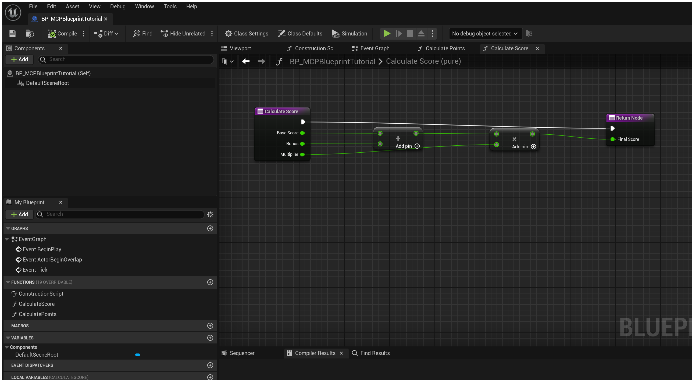

### 复杂正式业务流程全图

`EvaluateOrderBatchV2` 展示一个订单结算函数如何在同一张图中处理订单累计、折扣、运费、税费、积分、风险分数和最终结果。

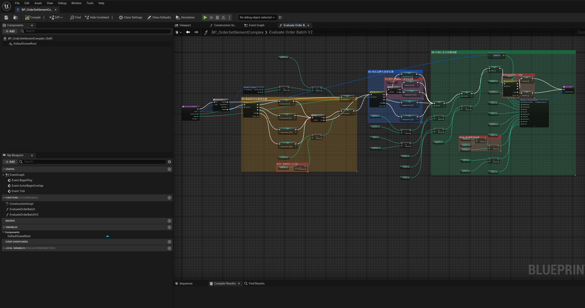

### 修改 1：Region 1 增加首单免运费

修改前，Region 1 直接执行 `ShippingCents = 1000`，不区分是否为首单。

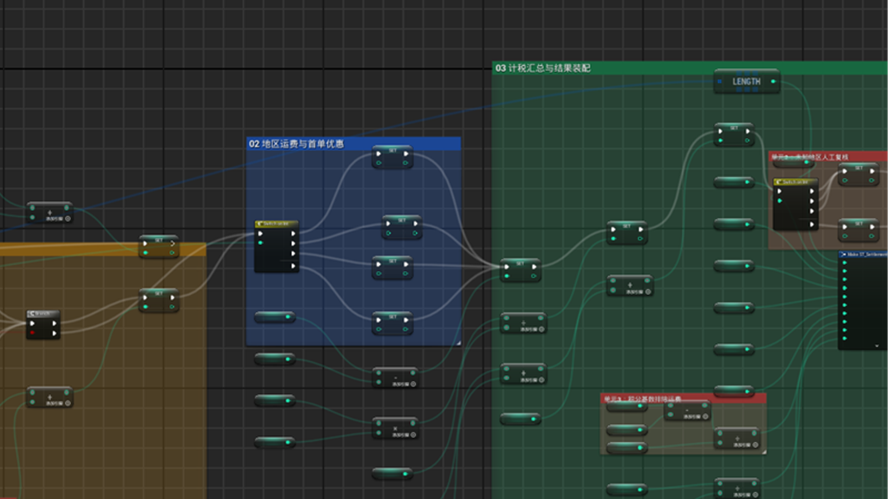

修改后，Region 1 增加 `FirstOrder` 分支：首单运费为 `0`，其他订单仍为 `1000`。

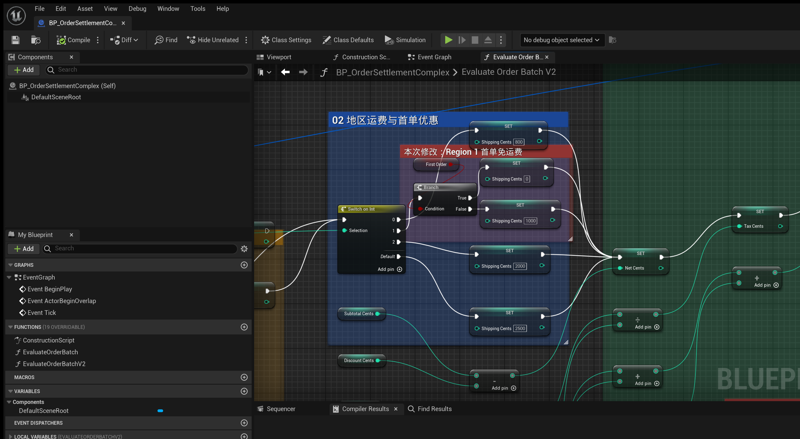

### 修改 2：积分基数排除运费

修改前：`PointsEarned = TotalCents / 100`。

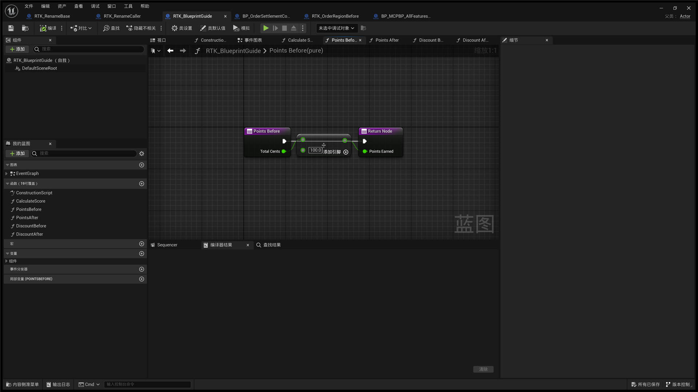

修改后：`PointsEarned = (TotalCents - ShippingCents) / 100`，新增 Subtract 节点以排除运费。

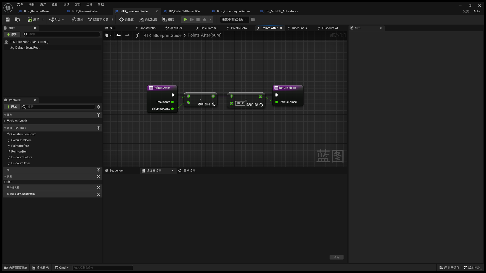

### 修改 3：首单折扣由固定值改为小计 5%

修改前：`SubtotalCents × 0` 后再加固定值 `500`，因此输出始终是固定折扣 `500`。

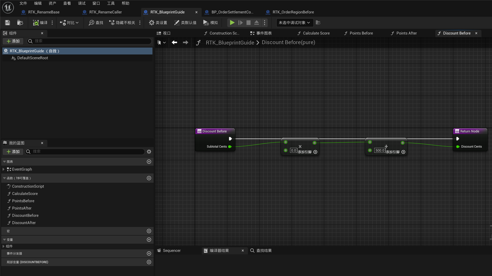

修改后：固定值路径改为 `SubtotalCents / 20`，即小计的 5% 折扣。

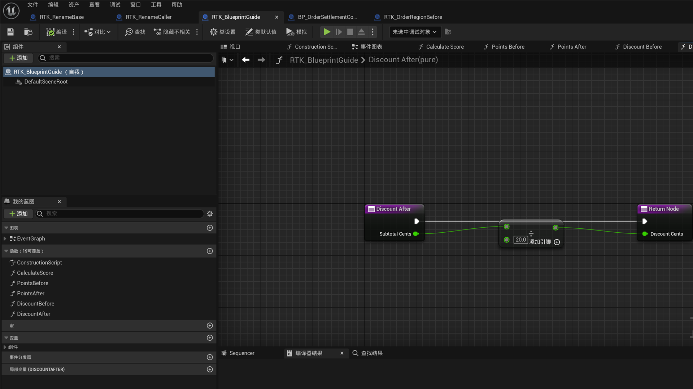

修改逻辑前，先使用 dry-run（若工具支持）了解影响；涉及引用更新或数据丢失时，按工具要求显式批准。需要保留改动时使用 `SaveAsset`。

## 查找资产与图表

- 用 `ListBlueprints` 分页查找资产。
- 用 `GetBlueprintOverview` 查看图、变量、函数、组件、接口和父类。
- 用 `ListBlueprintMembers` 查看函数、自定义事件、事件分发器和局部变量。
- 用 `GetGraphDetail` 查看节点、Pin、默认值、连线和布局。
- 用 `GetCompileErrors` 或 `CompileBlueprint` 查看编辑器诊断。

使用插件返回的资产路径。大型图请分页查看，避免一次返回过多内容。

## 编辑函数局部变量

1. 用 `ListBlueprintMembers` 找到局部变量，复制其完整 `Target`。`FunctionGraphGuid` 标识函数图，`VarGuid` 标识声明；可选 `Name` 若提供，必须与当前名称完全一致。
2. 将资产路径放入 `BlueprintPath`，把复制的对象放入 `Target`，再提供至少一个字段：`NewName`、`TypeName`、`DefaultValue`、`Category`、`Tooltip`。例如，提供 `DefaultValue: ""` 预览清空默认值，或同时提供 `NewName: "TemporaryScore"` 和 `Category: "Calculation"` 预览改名与分类。
3. `bDryRun` 默认 `true`。预览会列出引用及可能断开的连线；`MaxResults` 为 1–100，默认 50，只限制显示行数。
4. 应用同一请求时显式设置 `bDryRun: false`、`bApproveReferenceUpdates: true`。只要提供 `TypeName`，还要设置 `bAllowPotentialDataLoss: true`。需要保存时调用 `SaveAsset`。

省略的字段保持原值。真实改型且未提供 `DefaultValue` 时会清空默认值；相同类型不会误清。空分类恢复引擎默认分类，空提示移除提示元数据。同名成员、其他函数的同名局部变量不会随目标改名；与直接子蓝图成员冲突的新名称会被拒绝。

非空默认值支持数值、布尔、枚举、Name、字符串、安全数学结构，以及元素同样安全的 Array/Set/Map。顶层硬对象或类引用须已在内存中，并满足路径、类型和真实函数入口的访问权限；跨包私有对象会被拒绝。顶层软引用按其类型规则处理。非空 Text、嵌套对象/软引用、含对象的结构、接口或委托值，以及无法安全处理的原生结构会被拒绝。空默认值用于恢复类型初值；改名、分类和提示不会重新导入未修改的默认值。

## 安全添加图表逻辑

使用 Unreal 英文动作名搜索，例如 `Branch`、`For Loop`、`For Each Loop`、`Switch on Int`、`Switch on Name`、`Switch on String`、`Add`、`Subtract`、`Multiply` 或 `Divide`。

`ApplyGraphPatch` 支持：

- 带临时 ID 和 Action Registry `SpawnerId` 的 `Nodes`。
- `Connections` 与 `Disconnections`。
- 通过节点标识定位的 `RemoveNodes`。
- 通过节点标识和图坐标定位的 `MoveNodes`。
- 可选的 `PinDefaults`、`PromotedType`、布局范围和布局风格。

整个 Patch 只使用自己的事务，失败时会检查 Undo 记录归属并尝试恢复。`ApplyGraphPatch`、`ModifyVariable`、`ModifyLocalVariable` 和 `ModifyFunctionSignature` 的恢复响应带有 `RecoveryContractVersion: 2`，仍作为错误返回。查看以下字段后再决定下一步：

| 字段 | 含义 |
|---|---|
| `bUndoSucceeded` | 本次调用自己的 Undo 成功；不会撤销后来加入的其他事务。 |
| `bContentRestored`、`bSnapshotRestored` | 声明、图、节点和 Pin 内容与操作前相同。`bRolledBack` 还要求自己的 Undo 成功。 |
| `RuntimeVerification` | `Verified` 表示运行时形状与默认值相同；`Different` 表示存在差异；`Unavailable` 表示无法完整检查；`NotRequested` 表示未要求检查。只有 `Verified` 时 `bRuntimeRestored` 才为 true。 |
| `RecoveryAssets` | 各蓝图操作前后的实际 `Status`、状态码和包 Dirty；内容恢复后仍可能是 Dirty。 |
| `bRollbackStateRestored` | 内容、所需运行时与原生状态均相同。工具不会为满足此字段而回填 Status 或清除 Dirty。 |
| `RollbackRecoveryCompileReports` | 必要恢复编译的实际结果；编译成功还须通过内容和运行时比较。 |
| `DefaultRepairResult`、`DefaultRepairProperties` | 变量恢复编译后对指定成员默认值的恢复结果和属性路径；`Applied` 仍须通过最终全量比较。 |
| `AuthoringDifference`、`RuntimeDifference`、`RecoveryError` | 未恢复内容或无法检查的位置和原因。 |

若出现内容差异、运行时差异或无法证明恢复，请停止修改并检查当前资产。Dirty 或已有编译错误的图仍可建图；蓝图缺少 Undo 所需的实际生成类/CDO 时会返回 `RecoveryUnavailable`，不会偷偷先编译。

## 成员、函数、Struct 与 Enum

- 变量工具管理类型、默认值、Category、Tooltip 和安全删除。
- 函数工具创建、重命名、执行受支持的签名修改，或安全删除用户函数。
- 局部变量操作需要函数图和变量声明标识。
- Struct/Enum 修改使用字段或条目标识，并会报告引用影响。
- 可能丢失数据或改变 Enum 序列化值语义的操作需要独立显式批准。

函数重命名和签名修改会先分析影响。遇到无法安全处理的 Override、Delegate 绑定、派生类或引用时，工具会拒绝操作，不会勉强修改。

### 函数重命名示例

下面两张图展示函数改名后的定义与调用点。改名前先使用 dry-run；工具要求更新引用时，必须显式批准。需要保留改动时使用 `SaveAsset`。

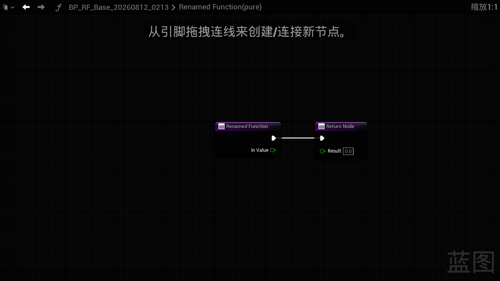

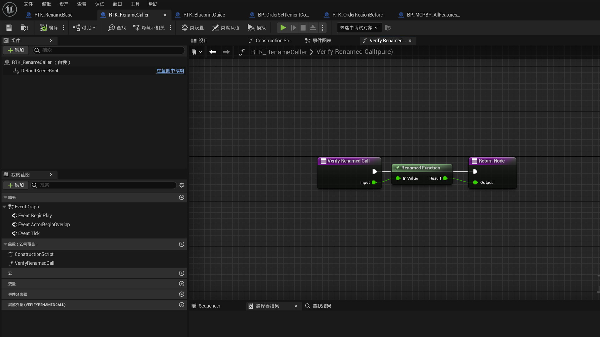

### 函数、事件与绑定事件示例

以下示例展示带输入输出参数的函数、组件事件辅助函数图，以及 Actor 生命周期、组件绑定事件和可变 Pin 的常见结构。

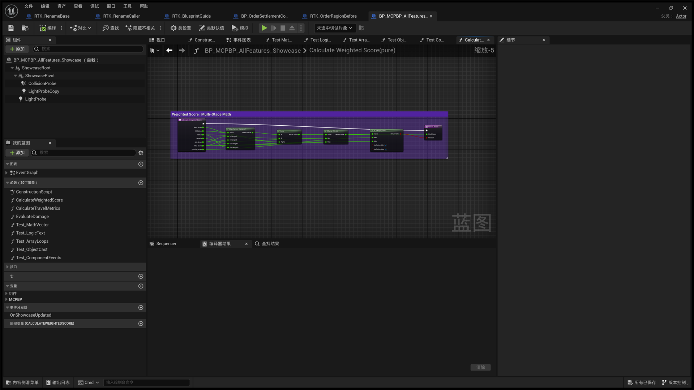

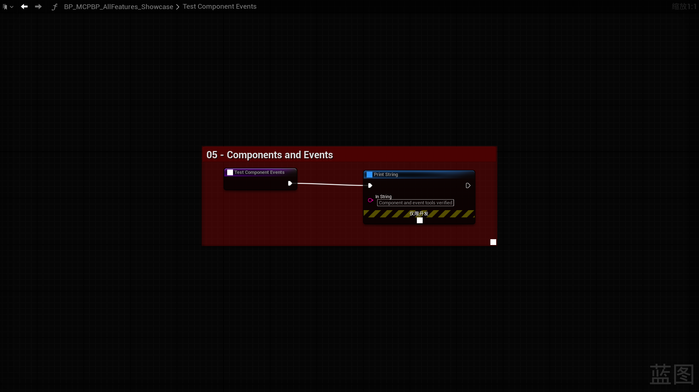

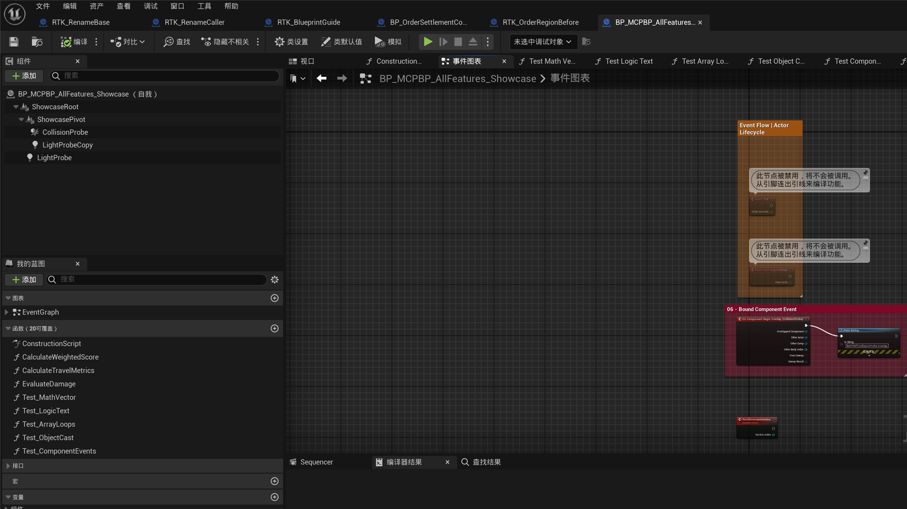

### 连接 Event Dispatcher

先用 `AddEventDispatcher` 声明分发器，例如 `OnSignal`，输入 `Payload:int`。随后调用 `SearchGraphNodes`，传入目标 `BlueprintPath`、`GraphName` 和 `Query="OnSignal"`，获取真实节点和 Pin。

- `Bind`：添加一个接收事件。
- `Call`：广播输入参数，调用所有已绑定的接收事件。
- `Unbind`：移除指定接收事件。
- `UnbindAll`：移除该分发器的所有接收事件。

用 `CreateCustomEvent` 创建输入签名相同的接收事件，再用 `ApplyGraphPatch` 创建搜索返回的节点。把接收事件的 `@<NodeGuid>.OutputDelegate` 连到 Bind 或 Unbind 的 `Delegate` Pin；把发起事件的 `then` 连到 Bind 的 `execute`，再把 Bind 的 `then` 连到 Call 的 `execute`。Call 的 `Payload` 可以通过 `PinDefaults` 设置，也可以连接数据来源。完成后用 `GetGraphDetail` 核对连线和编译结果，使用 `SaveAsset` 保存。

这四种操作当前只支持目标蓝图自身声明的标量分发器。`Delegate:<操作>:self:<声明GUID>` 标识在编译和保存后保持稳定；删除后同名重建会产生新 GUID，旧标识会被拒绝，应重新搜索。Assign、CreateDelegate、继承或跨蓝图目标，以及分发器签名修改和改名迁移仍待支持。

### 修改本地函数显示与编辑器属性

`ListBlueprintMembers` 的函数 `Inputs`、`Outputs` 仍按名称字母顺序返回。每个函数参数额外包含 `DeclarationIndex`（其所属入口或结果 Terminal 声明数组中的零基下标）、`bIsReference` 和 `bIsConst`。下标属于各 Terminal，并非整个函数的唯一序号。`bIsReference`、`bIsConst` 表示声明的 raw 值。`bCompiledFlagsKnown=true` 时，还返回当前自有编译函数的 `bCompiledReference`、`bCompiledConst` 和 `bCompiledOutParm`；不可用时仅返回 `bCompiledFlagsKnown=false`，不把未知标志写成 false。查询不会触发编译，可先正常编译蓝图再读取。引用输入也可能带 OutParm，它仍属于逻辑输入组。原有分页、16 个 Pin 的签名上限及默认值截断规则保持有效；CustomEvent、EventDispatcher 返回字段保持原样。

用 `MemberKind: "Function"` 调用 `ListBlueprintMembers`，把函数的 `Name` 和 `FunctionGraphGuid` 放入 `Kind: "Function"` 的 `Target`。`NodeGuid` 标识入口节点，不能代替图 GUID。先用相同 Target 调用 `GetBlueprintDetails` 查看可用属性和编辑限制，再调用 `ModifyFunctionDetails`：

```json
{"BlueprintPath":"/Game/Blueprints/BP_Player","Target":{"Kind":"Function","Name":"SendSignal","FunctionGraphGuid":"<ListBlueprintMembers 返回的 FunctionGraphGuid>"},"DisplayName":"Send Signal","Tooltip":"Sends the current payload.","Category":"Signals","Keywords":"payload emit","CompactTitle":"SEND","bCallInEditor":true,"bDeprecated":false,"DeprecationMessage":""}
```

`DisplayName` 修改调用节点标题；`Tooltip` 提供函数提示；`Category` 控制菜单分类；`Keywords` 便于动作搜索；`CompactTitle` 设置紧凑调用节点标题。`bCallInEditor` 仅声明函数可从编辑器调用，不执行函数。`bDeprecated` 标记函数使用已弃用，启用该标记时 `DeprecationMessage` 提供替代建议。可用新显示名、分类或关键词调用 `SearchGraphNodes` 查找调用动作。

遗漏字段保持原值；空文本清除对应内容，空 `Category` 恢复 Unreal 默认分类。分类、关键词与紧凑标题会去除首尾空白。清除 `CompactTitle` 会恢复普通调用标题并保留关键词。弃用函数只有在 Blueprint Editor 中启用显示弃用函数的设置（`bExposeDeprecatedFunctions`）后，才会出现在动作搜索中。工具会编译蓝图，需要保留修改时调用 `SaveAsset`；无实际变化的请求会被拒绝。重写／接口实现、RepNotify、构造和其他受保护函数只读。此工具不修改 Pure、Const、访问级别、签名或 RPC 声明。

### 修改自定义事件属性与 RPC

从 `CreateCustomEvent` 或 `GetGraphDetail` 获取事件的 `NodeGuid`，用相同 `Target` 调用 `GetBlueprintDetails` 和 `ModifyCustomEvent`。例如，把本地事件声明为可靠的服务端 RPC：

```json
{"BlueprintPath":"/Game/Blueprints/BP_Player","Target":{"Kind":"CustomEvent","NodeGuid":"<事件的 NodeGuid>"},"Replication":"Server","bReliable":true}
```

`Replication` 可选 `None`、`Server`、`Client`、`Multicast`。`None` 停用 RPC，未传 `bReliable` 时保留声明中保存的可靠位；它在非 RPC 模式下不生效。显式设置或清除 `bReliable` 时，最终模式必须是 RPC，可在同一个请求中指定模式。Details 的 `Current` 显示保存值，`Effective` 显示当前生效的 RPC 和可靠位。

`bCallInEditor` 控制编辑器可调用声明，工具不会执行事件；`bDeprecated` 标记弃用，`DeprecationMessage` 保存弃用说明，空字符串清除说明。布尔值须使用 JSON `true`/`false`。遗漏的字段保持原值，相同状态请求报无变化。只支持本蓝图自身且编译成功的可编辑事件；覆盖、接口实现和已绑定分发器的接收事件会被拒绝。完成后用 `SaveAsset` 保存。这些设置不改变 Actor 的复制开关，联机运行仍须配置 Actor 复制、所有权和调用端。

## 组件与类默认值

添加、重命名、复制、重设父级、设置根组件、修改模板属性或删除组件前，先读取当前组件层级。类默认值工具读取或修改支持的 Blueprint 默认值，不会把实例值冒充为类默认值。

## 资产生命周期

资产工具可以创建、复制、重命名、重设父类、编译、打开、关闭、重载、删除和保存支持的蓝图资产。

- 磁盘重载默认 dry-run，丢弃内存状态前必须显式批准。
- 破坏性删除比普通图修改具有更严格的 Undo/Redo 和 Package 安全要求。

## 截取图表

先调用 `OpenAsset`，再使用 `CaptureGraphScreenshot`。可以截取完整图表、聚焦某个节点，或复用指定视口。分享图片前，请确认标题、Pin 和连线清晰可读。

截图工具要求已初始化的蓝图图表编辑器控件。未打开图表编辑器或图表控件尺寸为零时，截图请求会被拒绝。

## 设置

打开 **项目设置 → 插件 → MCP Blueprint**：

- **Port** — 默认 `8766`；被占用时最多尝试后续九个端口。
- **Auto Start** — 随编辑器启动服务器。
- **Auto Compile After Modify** — 支持的写操作完成后自动编译。
- **Request Timeout Seconds** — 普通工具超时。
- **Compile Timeout Seconds** — 编译类工具独立超时。

## 当前限制

- 支持 Windows、macOS 和 Linux Editor；不提供 Runtime/Shipping 模块。
- 暂无“调用任意 Blueprint 函数并返回运行结果”的通用工具。
- Custom Event 和 Event Dispatcher 的签名修改能力尚未达到普通函数签名修改的完整程度。
- 某些 Blueprint Action 无法安全处理时，工具会直接拒绝操作。
- 截图需要真实初始化的 Blueprint Graph Editor 控件。

## 故障排查

- **无法连接：** 使用工具栏显示的实际端点，配置端口可能已被占用。
- **找不到工具：** 刷新 `tools/list`，不要依赖旧缓存。
- **写入被拒绝：** 阅读所有 blocker 和批准参数要求，重试前重新读取目标。
- **编译失败：** 获取编译诊断，根据真实蓝图错误修复后再保存。
- **图表结果异常：** 对比前后的 `GetGraphDetail`，适用时执行 Undo。
- **插件提示重建：** 安装与引擎小版本完全匹配的包。
- **项目中找不到插件：** 核对插件是否安装在该引擎的 `Engine/Plugins/Marketplace`；不要用添加项目依赖的方式绕过。
- **UE 5.5 提示项目文件过期，原因是已安装的 MCPBlueprint 不在项目描述符中：** 选择 **Not Now（暂不）**。引擎插件仍会自动加载；选择 **Update（更新）** 会把 MCPBlueprint 写入项目 `.uproject`，形成当前安装模式明确要避免的项目侧依赖。

## 支持

如有问题或反馈，请使用[统一联系页面](https://mengzhishanghun.github.io/mengzhishanghun/contact/)。

### 读取蓝图类设置

普通蓝图可用 `GetBlueprintDetails` 与 `Target: {"Kind":"ClassSettings"}` 读取资产声明的 `DisplayName`、`Description`、`Category` 原始值，包括空字符串。该 Target 只接受 `Kind`，不要附加成员名称或 GUID。每个字段返回 `Current`、`Editable: false` 与 `Reason`，说明当前工具尚未开放类设置修改；`CoverageComplete` 保持 false。查询直接读取蓝图声明，不编译或创建 CDO，也不读取实例默认值。

### 创建与使用宏

`ModifyMacroDetails` 编辑已成功编译的普通蓝图中本地宏的原生输入 Tunnel 元数据。先用 `GetGraphDetail` 获取宏的 `GraphGuid`，再用 `Target: {"Kind":"Macro","Name":"Relay","GraphGuid":"<返回的 GUID>"}` 调用 `GetBlueprintDetails`，查看各属性的原始 `Current`、`Editable`、`Reason` 和 `Impact`。

用同一 Target 调用 `ModifyMacroDetails`，传入需要改变的 `Category`、`Tooltip`、`Keywords` 或 `CompactTitle` 字符串。省略字段保持原值；分类、关键词和紧凑标题会去除首尾空白。空分类恢复 Unreal 默认分类；空提示、关键词或紧凑标题只清除对应字段，清除紧凑标题仍保留独立关键词。动作搜索读取原生分类、关键词和提示，保持名称式 `SpawnerId`；原始提示为空时，搜索结果可以显示 Unreal 的宏实例默认提示。分类实质变更遇到同名 skeleton 或继承函数时拒绝。未知字段、null、过期标识和无实质变化的请求均拒绝。普通蓝图修改保全既有图标识、Pin 与连线，并编译修改。工具不改签名或名称；请显式保存资产。

原生宏库使用同一组 Target 和四个字段。`GetBlueprintDetails` 返回原始值及编辑能力。库须有有效 GeneratedClass，状态为 UpToDate、Warning 或 Dirty；缺少类、Error/Unknown 状态或正在编译时，写入前拒绝。新库尚未生成类时，先显式编译。展示编辑保留库现有状态，并保全已加载资产的权威图（含嵌套子图）中消费者的内容、状态及 dirty。不支持的 Blueprint 子类、自定义宏实例类型和未解析的相关引用会被拒绝；操作不会加载尚未加载的消费者包。

宏库展示编辑不主动请求完整蓝图编译。原生编辑器 Undo/Redo 可能重新生成 skeleton 并使库保持 Dirty；此时仍可继续修改展示字段。`bCompilationRequired`、`AfterStatus` 和 `bPackageDirty` 如实报告资产状态。操作失败时，`bContentRestored` 和 `bRollbackStateRestored` 分别表示内容恢复与编辑器状态恢复；内容恢复成功后库仍可能为 Dirty，响应仍为错误。请显式调用 `SaveAsset` 持久化库，metadata 操作不会修改或保存消费者。

`CreateBlueprint` 可选 `BlueprintKind: "MacroLibrary"`；省略时保持普通蓝图行为。宏库当前只支持合法原生父类，如 `/Script/Engine.Actor` 或 `/Script/CoreUObject.Object`，拒绝蓝图生成类作为父类。

新建资产先调用 `CompileBlueprint`，再调用 `CreateMacro`。创建要求当前蓝图已成功编译，并保全既有图和链接。执行 Pin 必须明确写 `TypeName: "exec"`；省略 `Inputs` 或 `Outputs` 不会自动增加执行 Pin。数据 Pin 沿用现有具体类型语法，不支持 wildcard、by-reference 或 const 签名。

```json
{
  "BlueprintPath": "/Game/Blueprints/BP_MacroLibrary",
  "MacroName": "Relay",
  "Inputs": [{"Name": "Enter", "TypeName": "exec"}, {"Name": "Value", "TypeName": "int"}],
  "Outputs": [{"Name": "Leave", "TypeName": "exec"}, {"Name": "Result", "TypeName": "int"}]
}
```

返回 `GraphGuid`、`EntryNodeGuid`、`ExitNodeGuid` 和真实 Pin 详情。Inputs 对应入口 Tunnel 的输出 Pin；Outputs 对应出口 Tunnel 的输入 Pin。使用 `ApplyGraphPatch` 连接宏内部逻辑；`GetGraphDetail` 也会返回 `GraphGuid`。

在实际消费图中调用 `SearchGraphNodes` 获得精确宏 `SpawnerId`，通过 `ApplyGraphPatch` 放置并连线，再编译消费蓝图。普通蓝图中的宏仅在本蓝图使用；宏库可用性遵循原生父类和官方 ActionFilter。现有图上下文检查会拒绝自递归及函数中使用 latent 宏。本工具不修改已有宏签名，不提供宏重命名或删除传播。宏库与消费蓝图都需明确 `SaveAsset` 保存。
